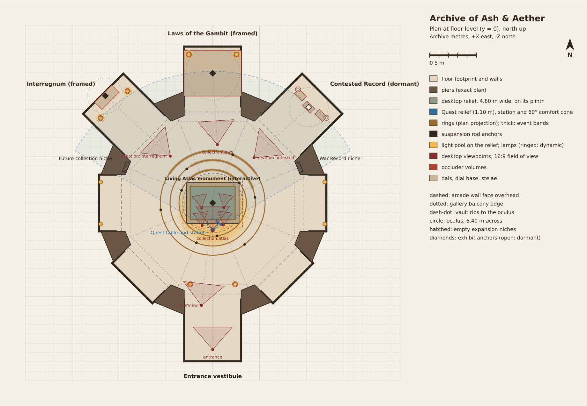
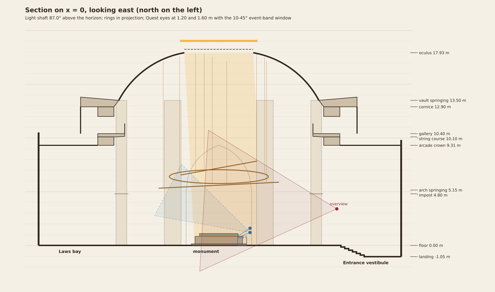

# Archive blueprint

*Generated from `shared/chronicles/archive/blueprint.ts` by `scripts/chronicles/generate-archive-blueprint.ts`. Do not edit by hand:*
*change the data and run `cd main-game-vr && npx tsx ../scripts/chronicles/generate-archive-blueprint.ts` (add `--check` to compare).*

The annotated spatial blueprint of the Archive of Ash & Aether (working presentation title) for M1. Both renderers build from
this one description, and `shared/chronicles/archive/blueprint.test.ts` encodes its composition, comfort, occlusion and canon rules.
It states design language only: where the archive is, who made it and why the visitor may enter stay unstated.

**Units and conventions.** Archive metres. +X is east, +Y is up and -Z is north; the origin is the chamber centre on the main
floor. A `yaw` is a rotation about +Y as three.js applies it: 0 faces north (-Z) and a positive yaw turns toward the west
(counter-clockwise seen from above). A `bearing` is a compass bearing: 0 is north and positive turns toward the east
(bearing = -yaw). Elevations and pitches are above the horizontal. The data holds radians; this document prints degrees.

## Design rationale

**Composition.** One octagonal chamber with a strong vertical axis. Eight massive piers carry stilted pointed arches; engaged shafts rise from their inner faces through a gallery level into the eight ribs of a vault that converges on a high oculus. The monument lies on the floor under it, the three rings hang between them, and the light falls through the oculus across the relief. The first settled frame, from inside the entrance arch, holds all three.

**Bays.** The three bays open to the north-west, north and north-east, inside the comfort cone of the stationary viewer at the monument's south edge. The entrance vestibule lies to the south, behind that viewer, and descends seven steps, so the desktop camera rises into the light. The east, west, south-east and south-west sides are shallow blind recesses carrying abstract astronomical roundels.

**Light.** A single high key falls almost vertically through the oculus. Its pierced screen breaks the outer band of the pool into dappled light while the open centre covers the monument broadly; nothing is aimed at the map's centre. Warm lamps in the bays answer the cool high light, and the bays stay darker than the pool so the monument leads.

**Materials.** Warm limestone ashlar for the structure, dark polished floor stone worn along the paths, basalt for the plinth, voussoir bands and steps, and patinated bronze for the rings, rods, frame and dial. Ornament is abstract and astronomical: graduations, concentric bands, star-pierced tracery, and a coffered vault whose coffers diminish toward the oculus, each holding a small bronze star boss. No inscriptions, names, emblems, heraldry or narrative scenes, and shelving is never the motif.

**Canon.** Nothing marks the map centre: no element stands within 0.4 m of the vertical line above it up to the vault springing, and the rings are held at their rims. The oculus shows only sky and light. Where the archive is, who made it and why the visitor may enter stay unstated.

**Expansion.** Two empty niches in the piers flanking the outer bays stay visibly unoccupied: the east one is reserved for exhibits fed by the War Record, the west one for a future collection.

## Drawings

*Plan: `blueprint/archive-plan.svg` (sha256 `b45af2e1d6a6e8e9`), rasterised to PNG.*

*Section: `blueprint/archive-section.svg` (sha256 `abd44230ff894f4c`), rasterised to PNG.*

## Chamber

| Quantity | Value |
| --- | --- |
| Plan | regular octagon, 8 piers on a 11.20 m circle |
| Arcade plane apothem / across | 10.35 m / 20.69 m between opposite arcade planes |
| Inner wall face across | 19.49 m |
| Side length / clear arch span | 8.57 m / 6.07 m |
| Pier plan | kite 2.50 m wide at the arcade plane, 2.40 m deep (1.40 m inside the corner) |
| Arcade arch | stilted two-centred pointed, radius 4.37 m (0.72 x span), rise 4.16 m, 15 voussoirs 0.62 m deep, wall 1.50 m thick |
| Vault | octagon-to-circle shell on a circular meridian: springs at 13.50 m (apothem 9.30 m, tangent 62.0°), ribs at the eight corners |
| Oculus | 6.40 m open disc at 17.93 m; pierced screen with an open centre (0.46 of the radius), 16 bars and a dappled outer band |
| Footprint extent | x -13.85..13.85 m, z -16.75..16.95 m (40 corners) |

| Level | Height (m) |
| --- | --- |
| landing | -1.05 |
| floor | 0.00 |
| impost | 4.80 |
| arch-springing | 5.15 |
| arcade-crown | 9.31 |
| string-course | 10.10 |
| gallery | 10.40 |
| cornice | 12.90 |
| vault-springing | 13.50 |
| oculus | 17.93 |

| Side | Bearing | Opens to | Depth (m) | Width (m) | Zone |
| --- | --- | --- | --- | --- | --- |
| 0 | 0.0° | bay | 6.40 | 6.07 | laws |
| 1 | 45.0° | bay | 6.20 | 6.07 | contested |
| 2 | 90.0° | recess | 1.80 | 6.07 | chamber |
| 3 | 135.0° | recess | 1.80 | 6.07 | chamber |
| 4 | 180.0° | entrance | 6.60 | 6.07 | entrance |
| 5 | 225.0° | recess | 1.80 | 6.07 | chamber |
| 6 | 270.0° | recess | 1.80 | 6.07 | chamber |
| 7 | 315.0° | bay | 6.20 | 6.07 | interregnum |

## Architectural elements

Every element is a kernel builder with parameters (or a Blender GLB under `assets/chronicles` that replaces it with no code change),
placed once or as instances, with materials by slot and an occluder volume where it can hide an exhibit.

| Element | Mesh | Placement | Materials | Occluder | Zone |
| --- | --- | --- | --- | --- | --- |
| `floor` | `floor` | (0.00, 0.00, 0.00), yaw 0.0° | floor-stone, basalt, bronze | - | chamber |
| `piers` | `pier` niche=false | 6 instances | limestone, limestone-dressed, bronze, basalt | 6 (pier-0...) | chamber |
| `piers-niche` | `pier` niche=true | 2 instances | limestone, limestone-dressed, bronze, basalt | 2 (pier-1...) | expansion |
| `arcade` | `arcade-arch` | 8 instances | limestone, basalt, limestone-dressed | - | chamber |
| `string-course` | `octagon-moulding` profile=string, y=10.1, height=0.3 | (0.00, 0.00, 0.00), yaw 0.0° | limestone-dressed | - | chamber |
| `gallery` | `gallery` | 8 instances | limestone, basalt, bronze, limestone-dressed | - | chamber |
| `cornice` | `octagon-moulding` profile=cornice, y=12.9, height=0.6 | (0.00, 0.00, 0.00), yaw 0.0° | limestone-dressed | - | chamber |
| `vault-shell` | `vault-shell` | (0.00, 0.00, 0.00), yaw 0.0° | limestone, limestone-carved, limestone-dressed, bronze | - | chamber |
| `vault-ribs` | `vault-ribs` | (0.00, 0.00, 0.00), yaw 0.0° | limestone-dressed, bronze | - | chamber |
| `oculus-ring` | `oculus-ring` | (0.00, 17.93, 0.00), yaw 0.0° | limestone-dressed, bronze | - | chamber |
| `oculus-tracery` | `oculus-tracery` | (0.00, 18.25, 0.00), yaw 0.0° | tracery, limestone-dressed | - | chamber |
| `sky-disc` | `sky-disc` | (0.00, 19.03, 0.00), yaw 0.0° | sky | - | chamber |
| `bay-laws` | `bay` side=0, depth=6.4, back=panel, floor=flat, ribs=2 | (0.00, 0.00, -10.35), yaw 180.0° | limestone, floor-stone, limestone-carved, basalt, bronze, limestone-dressed | - | laws |
| `bay-contested` | `bay` side=1, depth=6.2, back=plain, floor=flat, ribs=2 | (7.32, 0.00, -7.32), yaw 135.0° | limestone, floor-stone, limestone-carved, basalt, bronze, limestone-dressed | - | contested |
| `bay-interregnum` | `bay` side=7, depth=6.2, back=dial-wall, floor=flat, ribs=2 | (-7.32, 0.00, -7.32), yaw -135.0° | limestone, floor-stone, limestone-carved, basalt, bronze, limestone-dressed | - | interregnum |
| `vestibule` | `bay` side=4, depth=6.6, back=door, floor=steps-down, ribs=2 | (0.00, 0.00, 10.35), yaw 0.0° | limestone, floor-stone, limestone-carved, basalt, bronze, limestone-dressed | - | entrance |
| `recess-2` | `bay` side=2, depth=1.8, back=roundel, floor=flat, ribs=0 | (10.35, 0.00, 0.00), yaw 90.0° | limestone, floor-stone, limestone-carved, basalt, bronze, limestone-dressed | - | chamber |
| `recess-3` | `bay` side=3, depth=1.8, back=roundel, floor=flat, ribs=0 | (7.32, 0.00, 7.32), yaw 45.0° | limestone, floor-stone, limestone-carved, basalt, bronze, limestone-dressed | - | chamber |
| `recess-5` | `bay` side=5, depth=1.8, back=roundel, floor=flat, ribs=0 | (-7.32, 0.00, 7.32), yaw -45.0° | limestone, floor-stone, limestone-carved, basalt, bronze, limestone-dressed | - | chamber |
| `recess-6` | `bay` side=6, depth=1.8, back=roundel, floor=flat, ribs=0 | (-10.35, 0.00, 0.00), yaw -90.0° | limestone, floor-stone, limestone-carved, basalt, bronze, limestone-dressed | - | chamber |
| `lamps-entrance` | `lamp-stand` height=2.15 | 2 instances | bronze, lamp-core | 2 (lamp-entrance-0...) | entrance |
| `lamps-interregnum` | `lamp-stand` height=2.15 | 2 instances | bronze, lamp-core | 2 (lamp-interregnum-0...) | interregnum |
| `lamps-laws` | `lamp-stand` height=2.15 | 2 instances | bronze, lamp-core | 2 (lamp-laws-0...) | laws |
| `lamps-contested` | `lamp-stand` height=2.15 | 2 instances | bronze, lamp-core | 2 (lamp-contested-0...) | contested |
| `sconces` | `lamp-sconce` | 4 instances | bronze, lamp-core | - | chamber |
| `suspension-rods` | `suspension-rods` radius=0.028 | (0.00, 0.00, 0.00), yaw 0.0° | bronze | - | mechanism |

## Monument

|  | Desktop | Quest |
| --- | --- | --- |
| Relief width x depth | 4.80 x 3.58 m | 1.10 x 0.82 m |
| Relief top (rim plane) | 1.10 m | seated 0.72 m, standing 0.86 m |
| Centre | (0.00, 0.00, 0.00) | (0.00, 0.00, 2.17) |
| Plinth | `plinth`, margin 0.42 m, step 0.34 m x 0.14 m | same builder, scaled to the relief |
| Bronze frame | band 0.06 m, rise 0.01 m | baked, unlit |
| Painting | the creator's map, unmodified, as the relief albedo | same file, mirrored |

## Mechanism

Three still rings, concentric on the vertical axis, each with one pivot (the axis normal to its plane) and held at its rim by
bronze rods hung from the vault. No hub, rod or anything else stands over the map centre. The event bands carry the Annals from M3.

| Ring | Radius | Centre | Tilt (x, y, z) | Section | Event band | Rods (rim angle -> vault anchor) |
| --- | --- | --- | --- | --- | --- | --- |
| `annals-ring-outer` | 5.60 m | (0.00, 5.60, 0.00) | -2.9°, 0.0°, 0.0° | 0.42 x 0.15 m | -55.0° to 55.0° | 22.5° -> 17.18 m; 142.5° -> 17.14 m; 262.5° -> 17.13 m |
| `annals-ring-middle` | 4.60 m | (0.00, 6.40, 0.00) | 0.0°, 0.0°, -8.0° | 0.42 x 0.15 m | -30.0° to 70.0° | 82.5° -> 17.58 m; 202.5° -> 17.57 m; 322.5° -> 17.57 m |
| `annals-ring-inner` | 3.60 m | (0.00, 7.20, 0.00) | -10.3°, 0.0°, 0.0° | 0.34 x 0.13 m | -45.0° to 45.0° | 52.5° -> 17.85 m; 172.5° -> 17.86 m; 292.5° -> 17.85 m |

## Exhibits (all four collections)

| Exhibit | Collection | M1 | Anchor | Yaw | Artifacts | Quest station (bearing, distance, height, scale) | Pick |
| --- | --- | --- | --- | --- | --- | --- | --- |
| `exhibit-atlas` | atlas | interactive | (0.00, 1.10, 0.00) | 0.0° | atlas-relief | 0.0°, 0.73 m, 0.72 m, 0.2292 | (0.00, 1.10, 0.00) r 3.00 m |
| `exhibit-interregnum` | interregnum | framed | (-11.47, 3.15, -11.47) | -135.0° | annals-dial, annals-ring-outer, annals-ring-middle, annals-ring-inner | -38.6°, 18.39 m, 3.15 m, 1 | (-11.47, 3.15, -11.47) r 1.90 m |
| `exhibit-laws` | laws | framed | (0.00, 0.45, -13.90) | 180.0° | laws-dais | 0.0°, 16.80 m, 0.45 m, 1 | (0.00, 1.00, -13.90) r 2.90 m |
| `exhibit-contested` | contested | dormant | (10.25, 1.15, -10.25) | 135.0° | contested-stele-west, contested-stele-centre, contested-stele-east | 37.9°, 16.67 m, 1.15 m, 1 | (10.25, 1.30, -10.25) r 2.10 m |

| Artifact | Kind | Mesh | Placement | Materials | Presents |
| --- | --- | --- | --- | --- | --- |
| `atlas-relief` | relief | `relief` | the monument | painting, basalt | korvenia, solforiz, aethelgard, kwind-09 |
| `annals-dial` | dial | `dial` | (-11.47, 3.15, -11.47), yaw -135.0° | bronze, basalt | year-0, years-1-12, year-19, year-33 |
| `annals-ring-outer` | ring | `ring-band` | from the mechanism | bronze | - |
| `annals-ring-middle` | ring | `ring-band` | from the mechanism | bronze | - |
| `annals-ring-inner` | ring | `ring-band` | from the mechanism | bronze | - |
| `laws-dais` | dais | `dais` | (0.00, 0.00, -13.90), yaw 180.0° | basalt, bronze, floor-stone | why-representatives, the-muster, law-of-the-pawn |
| `contested-stele-west` | document | `stele` | (9.37, 0.00, -11.56), yaw 135.0° | basalt, bronze | - |
| `contested-stele-centre` | document | `stele` | (10.25, 0.00, -10.25), yaw 135.0° | basalt, bronze | - |
| `contested-stele-east` | document | `stele` | (11.56, 0.00, -9.37), yaw 135.0° | basalt, bronze | - |

## Desktop viewpoints and camera framings

Restrained orbit and zoom about each authored framing; the renderer clamps to these limits (offsets in radians, zoom as distance factors).
`review:contested` is for captures only: the dormant bay is absent from navigation.

| Viewpoint | Eye | Target | FOV | Limits |
| --- | --- | --- | --- | --- |
| `entrance` | (0.00, 0.60, 15.70) | (0.00, 2.70, 0.00) | 52° | yaw -0.12..0.12, pitch -0.06..0.08, zoom 0.94..1.03 |
| `overview` | (-1.20, 3.40, 10.97) | (0.30, 4.20, -2.00) | 56° | yaw -0.06..0.06, pitch -0.05..0.05, zoom 0.95..1.03 |
| `collection:atlas` | (0.00, 5.26, 2.99) | (0.00, 1.09, 0.07) | 42° | yaw -0.25..0.25, pitch -0.20..0.15, zoom 0.75..1.10 |
| `collection:interregnum` | (-4.52, 2.35, -5.02) | (-11.47, 2.85, -11.47) | 46° | yaw -0.16..0.16, pitch -0.08..0.16, zoom 0.78..1.08 |
| `collection:laws` | (0.50, 3.10, -6.25) | (0.00, 1.15, -13.90) | 46° | yaw -0.17..0.17, pitch -0.10..0.14, zoom 0.80..1.08 |
| `nation:korvenia` | (-1.18, 3.22, 0.53) | (-1.44, 1.31, -0.90) | 35° | yaw -0.30..0.30, pitch -0.22..0.22, zoom 0.80..1.45 |
| `nation:solforiz` | (1.13, 3.21, 2.35) | (1.34, 1.10, 0.86) | 35° | yaw -0.30..0.30, pitch -0.22..0.22, zoom 0.80..1.45 |
| `nation:aethelgard` | (1.18, 3.20, 0.50) | (1.44, 1.29, -0.93) | 35° | yaw -0.30..0.30, pitch -0.22..0.22, zoom 0.80..1.45 |
| `nation:kwind-09` | (-1.13, 3.28, 2.42) | (-1.34, 1.13, 0.90) | 35° | yaw -0.30..0.30, pitch -0.22..0.22, zoom 0.80..1.45 |
| `review:contested` | (4.42, 2.40, -4.84) | (10.25, 1.40, -10.25) | 46° | yaw -0.15..0.15, pitch -0.08..0.12, zoom 0.82..1.06 |

### Navigation paths

Flights take at most 1.2 s and the entrance settle at most 1.5 s; reduced motion cuts them. Quest has no camera paths: the viewer is never moved.

| From | To | Via | Seconds |
| --- | --- | --- | --- |
| entrance | overview | (-0.60, 2.30, 13.33) | 1.40 |
| overview | collection:atlas | (-0.60, 4.93, 6.98) | 1.10 |
| collection:atlas | overview | (-0.60, 4.93, 6.98) | 1.10 |
| overview | collection:interregnum | (-2.86, 3.48, 2.97) | 1.10 |
| collection:interregnum | overview | (-2.86, 3.48, 2.97) | 1.10 |
| overview | collection:laws | (-0.35, 3.85, 2.36) | 1.10 |
| collection:laws | overview | (-0.35, 3.85, 2.36) | 1.10 |
| collection:atlas | collection:interregnum | (-2.26, 4.41, -1.01) | 1.20 |
| collection:interregnum | collection:atlas | (-2.26, 4.41, -1.01) | 1.20 |
| collection:atlas | collection:laws | (0.25, 4.78, -1.63) | 1.20 |
| collection:laws | collection:atlas | (0.25, 4.78, -1.63) | 1.20 |
| collection:interregnum | collection:laws | (-2.01, 3.33, -5.63) | 1.20 |
| collection:laws | collection:interregnum | (-2.01, 3.33, -5.63) | 1.20 |
| collection:atlas | nation:korvenia | (-0.59, 4.44, 1.76) | 0.90 |
| nation:korvenia | collection:atlas | (-0.59, 4.44, 1.76) | 0.90 |
| collection:atlas | nation:solforiz | (0.57, 4.44, 2.67) | 0.90 |
| nation:solforiz | collection:atlas | (0.57, 4.44, 2.67) | 0.90 |
| collection:atlas | nation:aethelgard | (0.59, 4.43, 1.74) | 0.90 |
| nation:aethelgard | collection:atlas | (0.59, 4.43, 1.74) | 0.90 |
| collection:atlas | nation:kwind-09 | (-0.56, 4.47, 2.70) | 0.90 |
| nation:kwind-09 | collection:atlas | (-0.56, 4.47, 2.70) | 0.90 |
| nation:korvenia | nation:solforiz | (-0.02, 3.51, 1.44) | 0.90 |
| nation:korvenia | nation:aethelgard | (0.00, 3.51, 0.52) | 0.90 |
| nation:korvenia | nation:kwind-09 | (-1.15, 3.55, 1.48) | 0.90 |
| nation:solforiz | nation:korvenia | (-0.02, 3.51, 1.44) | 0.90 |
| nation:solforiz | nation:aethelgard | (1.16, 3.50, 1.43) | 0.90 |
| nation:solforiz | nation:kwind-09 | (0.00, 3.54, 2.38) | 0.90 |
| nation:aethelgard | nation:korvenia | (0.00, 3.51, 0.52) | 0.90 |
| nation:aethelgard | nation:solforiz | (1.16, 3.50, 1.43) | 0.90 |
| nation:aethelgard | nation:kwind-09 | (0.03, 3.54, 1.46) | 0.90 |
| nation:kwind-09 | nation:korvenia | (-1.15, 3.55, 1.48) | 0.90 |
| nation:kwind-09 | nation:solforiz | (0.00, 3.54, 2.38) | 0.90 |
| nation:kwind-09 | nation:aethelgard | (0.03, 3.54, 1.46) | 0.90 |
| overview | review:contested | (1.61, 3.50, 3.06) | 1.20 |

## Quest vantages

One stationary station at the Quest monument's south edge, facing north. The floor is XR local-floor y = 0 (IWSDK's default
reference space); the runtime places the room from the real head pose on entry and on recenter, under a fade.

|  | Seated | Standing |
| --- | --- | --- |
| Station (floor) | (0.00, 0.00, 2.90) | (0.00, 0.00, 2.90) |
| Nominal eye height | 1.20 m | 1.60 m |
| Forward / comfort half-angle | 0.0° / 60.0° | 0.0° / 60.0° |
| Control surface (centre, yaw, pitch, width) | (0.64, 1.16, 2.13), -40.0°, 0.0°, 0.86 m | (0.64, 1.48, 2.13), -40.0°, 0.0°, 0.86 m |
| Relief far edge below the eye (min 22° / 28°) | 22.8° | 33.0° |
| Relief near edge ahead (min 0.30 m) | 0.32 m | 0.32 m |
| Relief top (0.65-0.90 m) | 0.72 m | 0.86 m |
| Exhibits off forward (max 60°) | atlas 0.0°, interregnum 38.6°, laws 0.0°, contested 37.9° | atlas 0.0°, interregnum 38.6°, laws 0.0°, contested 37.9° |
| Event band above the eye line (10-45°) | 25.9-42.9°, at most 43.7° off forward | 23.7-40.7°, at most 43.7° off forward |
| Control surface clear of the monument (pitch 0° / -20°) | 2.5° / 2.2° | 8.6° / 8.1° |
| Markers (min 4 cm and 6% of the relief width) | 6.60 cm | 6.60 cm |
| 16-unit body text at the control surface | 0.62° | 0.61° |

The control surface pose leaves the monument and the event band clear. At this width the current 16-unit body class subtends about 0.62°; the Quest
integration's 1.0° target needs about 26 units at this pose, or a wider panel.

## Lights

| Light | Kind | Position | Target | Colour | Intensity | Range / cone | Shadow | Desktop low / medium / high | Quest |
| --- | --- | --- | --- | --- | --- | --- | --- | --- | --- |
| `key-oculus` | key | (-0.80, 127.78, -5.70) | (0.12, 1.10, 0.87) | #fff1d6 | 7.50 | cone 1.80°, penumbra 0.32 | yes, cookie `oculus-cookie` | dynamic / dynamic / dynamic | baked |
| `fill-sky` | fill | (0.00, 17.93, 0.00) | - | #c9d4e2 over #4b3a29 | 0.55 | - | no | dynamic / dynamic / dynamic | baked |
| `fill-bounce` | fill | (0.12, 1.70, 0.87) | - | #ffcf96 | 2.20 | 15.00 m | no | baked / baked / baked | baked |
| `lamp-entrance-0` | practical | (2.40, 1.93, 8.70) | - | #ffb36b | 1.60 | 7.50 m | no | baked / baked / baked | baked |
| `lamp-entrance-1` | practical | (-2.40, 1.93, 8.70) | - | #ffb36b | 1.60 | 7.50 m | no | baked / baked / baked | baked |
| `lamp-interregnum-0` | practical | (-11.98, 1.93, -9.08) | - | #ffb36b | 1.60 | 7.50 m | no | baked / dynamic / dynamic | baked |
| `lamp-interregnum-1` | practical | (-9.08, 1.93, -11.98) | - | #ffb36b | 1.60 | 7.50 m | no | baked / dynamic / dynamic | baked |
| `lamp-laws-0` | practical | (-2.55, 1.93, -15.90) | - | #ffb36b | 1.60 | 7.50 m | no | baked / dynamic / dynamic | baked |
| `lamp-laws-1` | practical | (2.55, 1.93, -15.90) | - | #ffb36b | 1.60 | 7.50 m | no | baked / dynamic / dynamic | baked |
| `lamp-contested-0` | practical | (9.12, 1.93, -12.16) | - | #ffb36b | 0.00 | 7.50 m | no | omitted / omitted / omitted | omitted (dormant) |
| `lamp-contested-1` | practical | (12.16, 1.93, -9.12) | - | #ffb36b | 0.00 | 7.50 m | no | omitted / omitted / omitted | omitted (dormant) |
| `sconce-0` | practical | (11.97, 3.47, -2.25) | - | #ffb36b | 1.60 | 7.50 m | no | baked / baked / baked | baked |
| `sconce-1` | practical | (11.97, 3.47, 2.25) | - | #ffb36b | 1.60 | 7.50 m | no | baked / baked / baked | baked |
| `sconce-2` | practical | (-11.97, 3.47, 2.25) | - | #ffb36b | 1.60 | 7.50 m | no | baked / baked / baked | baked |
| `sconce-3` | practical | (-11.97, 3.47, -2.25) | - | #ffb36b | 1.60 | 7.50 m | no | baked / baked / baked | baked |
| `emissive-sky` | emissive | (0.00, 19.03, 0.00) | - | #fff6e6 | 3.20 | - | no | dynamic / dynamic / dynamic | baked |
| `emissive-lamp-cores` | emissive | (0.00, 2.15, 0.00) | - | #ffbf73 | 4.00 | - | no | dynamic / dynamic / dynamic | baked |

The key stands 87.00° above the horizon, leaning a few degrees to the north of straight overhead, and falls through the open oculus. Its fully lit cone covers
98.0% of the desktop relief and 100.0% of the Quest relief; the oculus screen dapples the pool's outer band.

## Atmosphere

| Volume | Kind | Centre | Size | Density | Axis | Colour |
| --- | --- | --- | --- | --- | --- | --- |
| `haze-chamber` | haze | (0.00, 7.00, -1.50) | (20.60, 16.00, 30.00) | 0.03 | - | #b8a587 |
| `shaft-oculus` | shaft | (0.07, 8.97, 0.47) | (6.40, 17.95, 6.40) | 0.42 | (0.01, -1.00, 0.05) | #ffe6bd |
| `dust-shaft` | dust | (0.09, 5.20, 0.66) | (5.60, 8.00, 5.60) | 1.40 | (0.01, -1.00, 0.05) | #ffe2b0 |

## Interaction zones

| Zone | Kind | Centre | Radius |
| --- | --- | --- | --- |
| `pick-atlas` | pick | (0.00, 1.10, 0.00) | 3.00 m |
| `pick-interregnum` | pick | (-11.47, 3.15, -11.47) | 1.90 m |
| `pick-laws` | pick | (0.00, 1.00, -13.90) | 2.90 m |
| `pick-contested` | pick | (10.25, 1.30, -10.25) | 2.10 m |
| `reach-seated` | reach | (0.00, 0.95, 2.60) | 0.75 m |
| `reach-standing` | reach | (0.00, 1.35, 2.60) | 0.75 m |
| `ray-seated` | ray | (0.00, 1.20, 2.90) | 20.00 m |
| `ray-standing` | ray | (0.00, 1.60, 2.90) | 20.00 m |
| `control-seated` | control | (0.64, 1.16, 2.13) | 0.43 m |
| `control-standing` | control | (0.64, 1.48, 2.13) | 0.43 m |
| `clearance-entrance` | camera-clearance | (0.00, 0.60, 15.70) | 0.30 m |
| `clearance-overview` | camera-clearance | (-1.20, 3.40, 10.97) | 0.30 m |
| `clearance-collection:atlas` | camera-clearance | (0.00, 5.26, 2.99) | 0.30 m |
| `clearance-collection:interregnum` | camera-clearance | (-4.52, 2.35, -5.02) | 0.30 m |
| `clearance-collection:laws` | camera-clearance | (0.50, 3.10, -6.25) | 0.30 m |
| `clearance-nation:korvenia` | camera-clearance | (-1.18, 3.22, 0.53) | 0.30 m |
| `clearance-nation:solforiz` | camera-clearance | (1.13, 3.21, 2.35) | 0.30 m |
| `clearance-nation:aethelgard` | camera-clearance | (1.18, 3.20, 0.50) | 0.30 m |
| `clearance-nation:kwind-09` | camera-clearance | (-1.13, 3.28, 2.42) | 0.30 m |
| `clearance-review:contested` | camera-clearance | (4.42, 2.40, -4.84) | 0.30 m |

## Expansion points

| Point | Reserved for | Position | Yaw | Size |
| --- | --- | --- | --- | --- |
| `expansion-war-record` | war-record | (9.05, 1.85, -3.75) | 112.5° | (1.10, 2.50, 0.42) |
| `expansion-collection` | collection | (-9.05, 1.85, -3.75) | -112.5° | (1.10, 2.50, 0.42) |

Both niches stay visibly empty until real content exists, and both lie inside the Quest comfort cone.

## Occluders and occlusion analysis

| Occluder | Kind | Centre | Size | Yaw |
| --- | --- | --- | --- | --- |
| `pier-0` | prism | (4.29, 6.75, -10.35) | (3.53, 13.50, 2.40) | 157.5° |
| `pier-1` | prism | (10.35, 6.75, -4.29) | (3.53, 13.50, 2.40) | 112.5° |
| `pier-2` | prism | (10.35, 6.75, 4.29) | (3.53, 13.50, 2.40) | 67.5° |
| `pier-3` | prism | (4.29, 6.75, 10.35) | (3.53, 13.50, 2.40) | 22.5° |
| `pier-4` | prism | (-4.29, 6.75, 10.35) | (3.53, 13.50, 2.40) | -22.5° |
| `pier-5` | prism | (-10.35, 6.75, 4.29) | (3.53, 13.50, 2.40) | -67.5° |
| `pier-6` | prism | (-10.35, 6.75, -4.29) | (3.53, 13.50, 2.40) | -112.5° |
| `pier-7` | prism | (-4.29, 6.75, -10.35) | (3.53, 13.50, 2.40) | -157.5° |
| `monument-desktop` | box | (0.00, 0.80, 0.00) | (6.36, 1.60, 5.14) | 0.0° |
| `dais-laws` | box | (0.00, 0.23, -13.90) | (6.10, 0.45, 4.90) | 180.0° |
| `dial-base` | box | (-11.31, 0.60, -11.31) | (2.60, 1.20, 1.10) | -135.0° |
| `stele-west` | box | (9.37, 1.25, -11.56) | (1.15, 2.50, 0.70) | 135.0° |
| `stele-centre` | box | (10.25, 1.25, -10.25) | (1.15, 2.50, 0.70) | 135.0° |
| `stele-east` | box | (11.56, 1.25, -9.37) | (1.15, 2.50, 0.70) | 135.0° |
| `lamp-entrance-0` | cylinder | (2.40, 1.07, 8.70) | (0.56, 2.15, 0.56) | 0.0° |
| `lamp-entrance-1` | cylinder | (-2.40, 1.07, 8.70) | (0.56, 2.15, 0.56) | 0.0° |
| `lamp-interregnum-0` | cylinder | (-11.98, 1.07, -9.08) | (0.56, 2.15, 0.56) | 0.0° |
| `lamp-interregnum-1` | cylinder | (-9.08, 1.07, -11.98) | (0.56, 2.15, 0.56) | 0.0° |
| `lamp-laws-0` | cylinder | (-2.55, 1.07, -15.90) | (0.56, 2.15, 0.56) | 0.0° |
| `lamp-laws-1` | cylinder | (2.55, 1.07, -15.90) | (0.56, 2.15, 0.56) | 0.0° |
| `lamp-contested-0` | cylinder | (9.12, 1.07, -12.16) | (0.56, 2.15, 0.56) | 0.0° |
| `lamp-contested-1` | cylinder | (12.16, 1.07, -9.12) | (0.56, 2.15, 0.56) | 0.0° |

Each desktop framing's orbit, tilt and zoom range is sampled on a 5 x 5 x 3 grid. A sphere of radius 0.25 m is swept from the framing
target and from the exhibit's centre to every sampled eye, against every occluder except the exhibit's own volumes.

| Framing | Subject | Samples | Occluders hit | Nearest solid to a sampled eye |
| --- | --- | --- | --- | --- |
| `entrance` | exhibit-atlas | 75 | none | 0.62 m |
| `overview` | exhibit-atlas | 75 | none | 0.99 m |
| `collection:atlas` | exhibit-atlas | 75 | none | 1.04 m |
| `collection:interregnum` | exhibit-interregnum | 75 | none | 1.30 m |
| `collection:laws` | exhibit-laws | 75 | none | 0.80 m |
| `nation:korvenia` | exhibit-atlas | 75 | none | 2.55 m |
| `nation:solforiz` | exhibit-atlas | 75 | none | 2.00 m |
| `nation:aethelgard` | exhibit-atlas | 75 | none | 2.53 m |
| `nation:kwind-09` | exhibit-atlas | 75 | none | 2.35 m |
| `review:contested` | exhibit-contested | 75 | none | 1.70 m |

Every framing is clear, so the occlusion reveal (D8) is not in M1 scope. Rings and rods are thin and never hide more than a thin arc; they are not occluder volumes.

## Composition and canon checks

| Check | Result |
| --- | --- |
| Overview at 16:9 holds the whole monument | yes |
| Share of the ring band in the overview (min 60%) | 100.0% |
| Light shaft in the overview, from the relief up to the ring band (7.84 m) | yes |
| Nearest element to the desktop map centre's vertical (min 0.40 m) | 3.37 m |
| Nearest element to the Quest map centre's vertical (min 0.40 m) | 1.20 m |
| Above the crown | only the oculus screen (open centre) and the sky disc |
| Ornament | abstract and astronomical; no text, names, emblems, heraldry or narrative scenes |

## Budgets

| Quality | Draw calls | Triangles | Texture memory |
| --- | --- | --- | --- |
| quest | 120 | 250,000 | 64 MB |
| low | 120 | 300,000 | 96 MB |
| medium | 250 | 1,000,000 | 192 MB |
| high | 400 | 1,500,000 | 320 MB |

Quest and desktop medium carry the directive's limits; low and high follow the My Legacy performance standard. Measured counts are
reported by the renderers and recorded with the M1 evidence.

The kernel's own share, computed from this data (the architecture, mechanism and exhibits, before the relief and the plinth), and the
texture estimate of the generated materials (4 bytes per texel, mipmaps counted, the map included):

| Quality | Kernel triangles | Kernel budget | Static batches | Instanced | Texture estimate |
| --- | --- | --- | --- | --- | --- |
| quest | 59,442 | 150,000 | 10 | - | 25.3 MB (7 files) |
| low | 75,454 | 200,000 | 10 | - | 42.6 MB (20 files) |
| medium | 204,692 | 640,000 | 10 | baluster x 144 | 114.6 MB (20 files) |
| high | 310,202 | 1,000,000 | 10 | baluster x 144 | 114.6 MB (20 files) |

## Framing subjects

| Viewpoint | Keeps visible |
| --- | --- |
| `entrance` | exhibit-atlas |
| `overview` | exhibit-atlas |
| `collection:atlas` | exhibit-atlas |
| `collection:interregnum` | exhibit-interregnum |
| `collection:laws` | exhibit-laws |
| `nation:korvenia` | exhibit-atlas |
| `nation:solforiz` | exhibit-atlas |
| `nation:aethelgard` | exhibit-atlas |
| `nation:kwind-09` | exhibit-atlas |
| `review:contested` | exhibit-contested |
